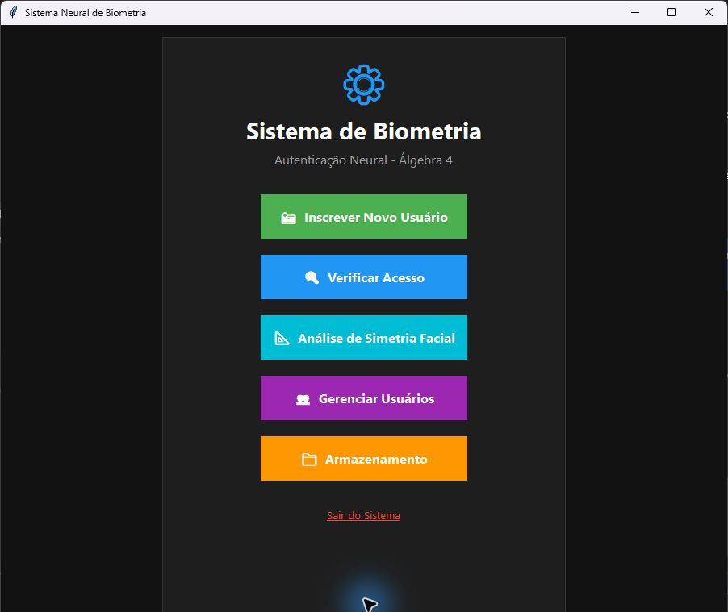
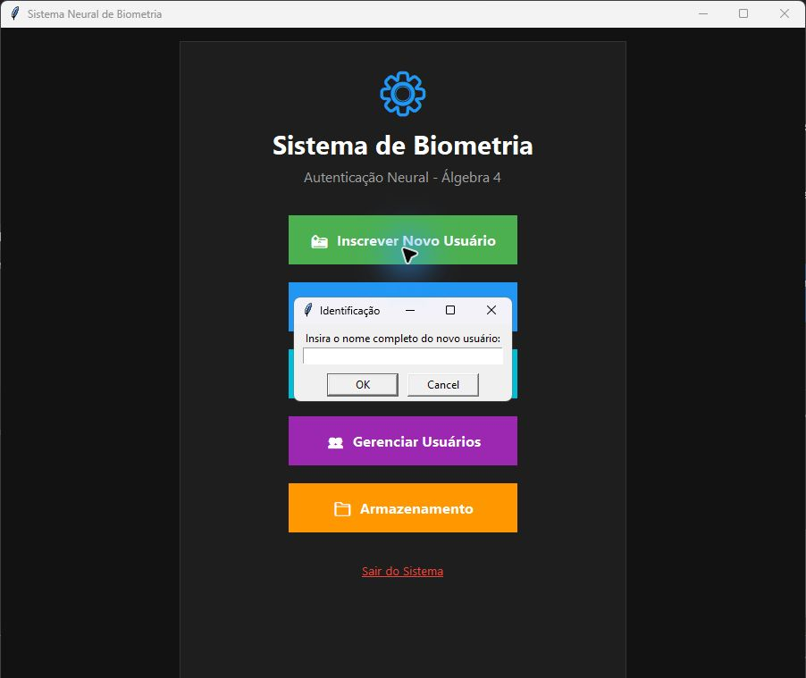
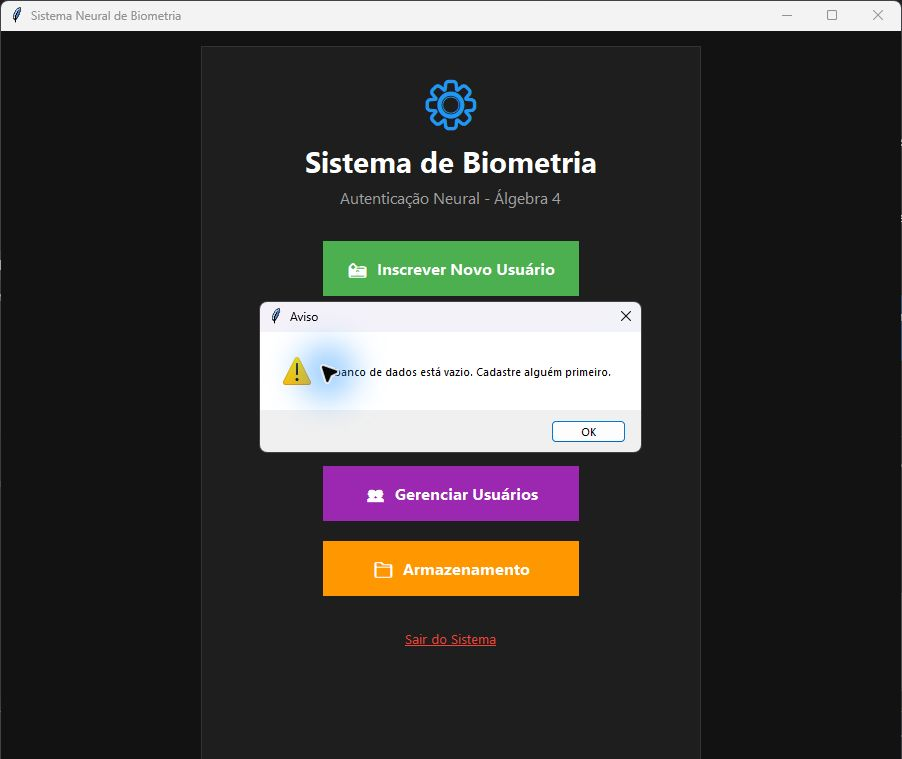
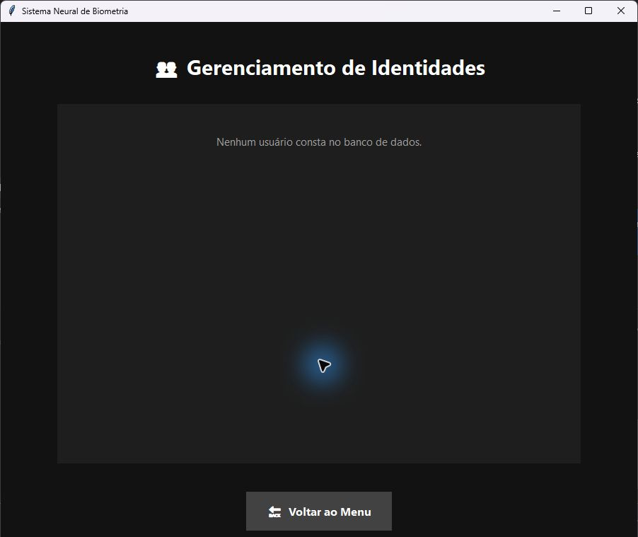
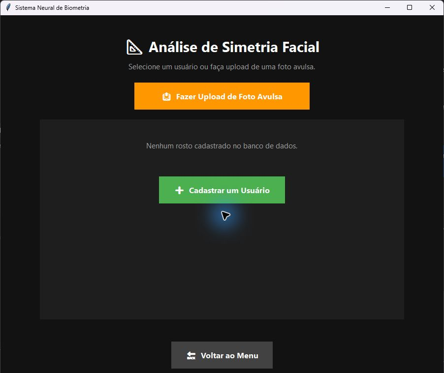
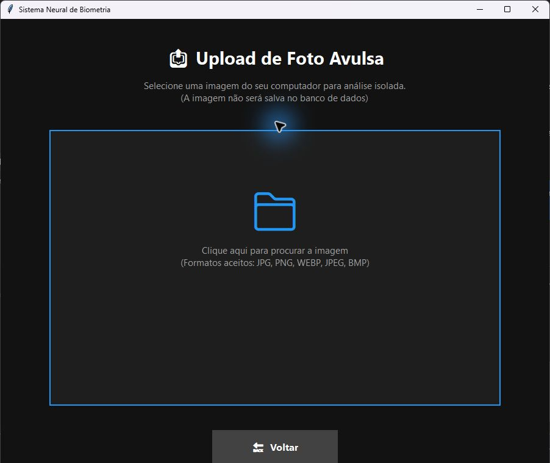

# Sistema de Biometria e Reconhecimento Facial

O código da versão original está em [`semAPI/`](semAPI/).
A versão com API local, InsightFace e MediaPipe está em [`comAPI/`](comAPI/README.md),
com cadastro, reconhecimento facial, malha de polígonos e análise de simetria.
O ponto de entrada é `comAPI/app_biometria.py`, que também inicia a API local.


[](https://github.com/BruMosteck/Sistema-de-Biometria/releases)

Aplicação desktop de cadastro, reconhecimento e análise de simetria facial desenvolvida para a disciplina de **Álgebra Linear da ESEG — Grupo ETAPA**.

## 🖥️ Sobre o projeto

A interface em Tkinter permite cadastrar pessoas com a webcam, reconhecer rostos em tempo real e analisar a simetria bilateral de um rosto cadastrado ou de uma foto avulsa. O aplicativo desktop armazena as fotos de cadastro localmente e gera os vetores de referência ao carregar a base.

## 📐 Fundamentação teórica

### 1. Imagens como matrizes

Uma imagem colorida de altura $H$ e largura $W$ pode ser representada por um arranjo $H \times W \times 3$. Cada canal é uma matriz de intensidades e cada pixel de uma imagem de 8 bits contém três valores entre 0 e 255. O OpenCV entrega os quadros da webcam em BGR. Antes da detecção, o aplicativo converte o quadro para RGB e reduz a largura e a altura a 25% do tamanho original, deixando aproximadamente 1/16 dos pixels para o processamento em tempo real.

### 2. Extração de características e redução de dimensionalidade

O detector HOG (*Histogram of Oriented Gradients*) localiza os rostos no quadro. A função `face_encodings` usa pontos de referência faciais para alinhar cada rosto e um modelo pré-treinado do dlib para convertê-lo em um *embedding* $\mathbf{x} \in \mathbb{R}^{128}$.

Uma imagem RGB de 150 × 150 pixels tem 67.500 intensidades quando representada como vetor. O modelo recebe um recorte facial alinhado desse tamanho e produz 128 coordenadas aprendidas. Esse mapeamento é não linear e foi treinado para aproximar representações de uma mesma pessoa no espaço vetorial. O redimensionamento do quadro reduz a quantidade de pixels processados. A extração do *embedding* reduz a dimensionalidade da representação usada na comparação.

### 3. Distância euclidiana e decisão

Para o vetor capturado $\mathbf{x}$ e cada vetor cadastrado $\mathbf{y}$, `face_distance` calcula a norma euclidiana da diferença.

$$
d(\mathbf{x},\mathbf{y}) = \lVert \mathbf{x}-\mathbf{y} \rVert_2
= \sqrt{\sum_{i=1}^{128}(x_i-y_i)^2}
$$

O aplicativo seleciona a amostra com a menor distância. Se essa distância for **menor ou igual a 0,50**, a interface exibe o nome associado à amostra. Se a base estiver vazia ou o menor valor ultrapassar o limiar, a interface exibe **ACESSO NEGADO**. O limiar é expresso em distância no espaço dos *embeddings*.

A similaridade de cossenos é uma métrica alternativa que compara a direção de dois vetores não nulos pelo produto escalar normalizado. Ela seria calculada por $\cos(\theta)=\frac{\mathbf{x}\cdot\mathbf{y}}{\lVert\mathbf{x}\rVert_2\,\lVert\mathbf{y}\rVert_2}$. A decisão deste projeto usa a distância euclidiana.

Referências técnicas · [Exemplo de reconhecimento do dlib](https://dlib.net/face_recognition.py.html) · [Implementação de `face_distance` e `face_encodings`](https://face-recognition.readthedocs.io/en/latest/_modules/face_recognition/api.html)

## 🗂️ Estrutura do código

| Arquivo | Função |
| --- | --- |
| [`app_biometria.py`](app_biometria.py) | Interface desktop, captura da webcam, armazenamento local, reconhecimento e análise de simetria. |
| [`1_cadastro.py`](1_cadastro.py) e [`2_reconhecimento.py`](2_reconhecimento.py) | Protótipos de terminal preservados para referência. O cadastro histórico usa Google Drive e requer configuração própria. |
| [`requirements.txt`](requirements.txt) | Dependências do aplicativo desktop no Windows x64. |
| [`Biometria ESEG.spec`](Biometria%20ESEG.spec) e [`hooks/`](hooks/) | Configuração do PyInstaller e inclusão dos modelos do dlib no pacote. |

## 📸 Telas do aplicativo

Capturas da versão Windows v1.0.0 em uma instalação com a base de cadastros vazia.

### Menu principal



O menu reúne os atalhos para cadastrar pessoas, verificar acesso, analisar simetria facial, gerenciar usuários e configurar o armazenamento.

### Cadastro de usuário



Ao escolher **Inscrever Novo Usuário**, o sistema solicita o nome que identificará o cadastro. A confirmação abre a etapa de captura de três fotos pela webcam.

### Verificação de acesso com a base vazia



Ao escolher **Verificar Acesso**, o aplicativo procura amostras de referência. Com a base vazia, ele solicita um cadastro antes de iniciar a câmera.

### Gerenciamento de identidades



A lista exibe as identidades da base local e permite remover cadastros existentes. Em uma instalação nova, a área da lista informa que ainda não há usuários.

### Análise de simetria facial



A tela permite selecionar um rosto já cadastrado ou iniciar a análise com uma foto avulsa. Com a base vazia, o botão **Cadastrar um Usuário** leva ao fluxo de cadastro.

### Foto avulsa



A área de seleção abre um arquivo local em JPG, JPEG, PNG, WEBP ou BMP para análise de simetria. A foto escolhida é carregada para essa análise e fica fora da base de cadastros.

## 🚀 Como executar

### Pacote para Windows

1. Na aba [Releases](https://github.com/BruMosteck/Sistema-de-Biometria/releases), baixe `Biometria-ESEG-Windows.zip` na versão `v1.0.0`.
2. Extraia o ZIP em uma pasta na qual você possa gravar arquivos.
3. Abra `Biometria ESEG.exe` dentro da pasta extraída, mantendo `_internal` ao lado do executável.
4. Cadastre um rosto e abra a verificação facial. O pacote começa com a base de cadastros vazia.

O `.exe` também está disponível como anexo separado para quem já tem a pasta `_internal` da mesma versão. Para instalar em outro computador, baixe o ZIP completo. O pacote inclui o runtime do Python.

### Código-fonte pelo VS Code

Instale o **Python 3.12 de 64 bits com Tkinter**, abra a pasta clonada no VS Code e rode no terminal PowerShell.

```powershell
py -3.12 -m venv .venv
& .\.venv\Scripts\python.exe -m pip install -r requirements.txt
& .\.venv\Scripts\python.exe -m pip install --no-deps face-recognition==1.3.0
& .\.venv\Scripts\python.exe .\app_biometria.py
```

`dlib-bin` fornece o módulo `dlib` pré-compilado. A opção `--no-deps` evita que o instalador tente compilar uma segunda distribuição de dlib. A webcam precisa estar disponível para os fluxos de cadastro e verificação.

## 👥 Participantes

| Participante | GitHub |
| --- | --- |
| Bruno Simcka Mosteck | [@BruMosteck](https://github.com/BruMosteck) |
| Miguel Narciso Freitas | [@DevFreitasMiguel](https://github.com/DevFreitasMiguel) |
| Henrique Pinheiro | [@PinheiroLim](https://github.com/PinheiroLim) |
